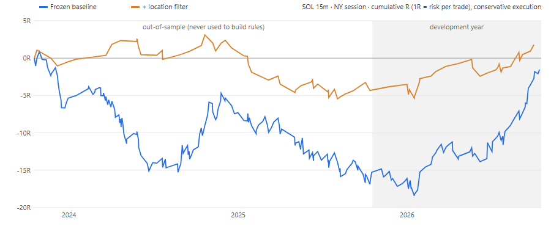

# SOL · NY session · SMC (CHoCH → FVG midpoint) — frozen backtest

Frozen research baseline for the strategy "CHoCH → first post-CHoCH FVG → limit entry at the
FVG midpoint", traded on SOLUSDT perpetual during the NY session. Structure (NY open line,
PDH/PDL, FVG, CHoCH, swings) comes from the app's **📐 SMC Toolkit** (`js/smc.js`, via its
headless `analyze()` hook), so the backtest sees exactly what the chart draws.

`MANIFEST.json` pins the data and code by SHA-256 plus the full frozen config. If a hash no
longer matches, the baseline has changed.

## Verdict (2026-10-19)

The 15m strategy made money only in the year the rules were evaluated on, and lost in both
earlier years that were never used. Over all three years it nets about zero. 1m loses in every
period, including with zero costs. **Neither version has a demonstrated edge.**

| 15m, conservative execution | Oct23–Oct24 | Oct24–Oct25 | Oct25–Oct26 (dev) | Out-of-sample total |
|---|---|---|---|---|
| Frozen baseline | PF 0.70 · −10.4R · 79 trades | PF 0.85 · −4.9R · 79 | PF 1.81 · +13.8R · 66 | PF 0.77 · −15.3R · 158 |
| + location (S/D or PDH/PDL) | PF 1.29 · +1.7R · 19 | PF 0.60 · −6.0R · 30 | PF 1.87 · +6.1R · 28 | PF 0.79 · −4.3R · 49 |
| + location, 2R target | PF 0.91 · −0.9R · 28 | PF 0.64 · −8.5R · 40 | PF 2.00 · +15.5R · 33 | PF 0.74 · −9.4R · 68 |

PF = profit factor. R = the amount risked per trade.

## Files

| File | Purpose |
|---|---|
| `engine.js` | Strategy engine (rules, fills, stops, breakeven, fees, slippage, funding, sizing) |
| `fetch.js` | Re-downloads candles from Bybit (1m data is git-ignored; see `MANIFEST.json`) |
| `regress.js` | Confirms the engine still reproduces the original development-year results |
| `audit.js` | Look-ahead audit: re-runs on truncated data and checks that no finished trade changes |
| `suite.js` | Execution stress tests, alternative targets, alternative confluence definitions |
| `oos.js` | Frozen rules on the out-of-sample years plus the development year |
| `robust.js` | Bootstrap confidence interval, period and side split, raw-candle spot checks |
| `curve.js` | Cumulative-R curve (`results/equity-15m.*`) |

Run from this folder with Node 18+, e.g. `node oos.js 15`. For the 1m runs, add `--max-old-space-size=8192`.
